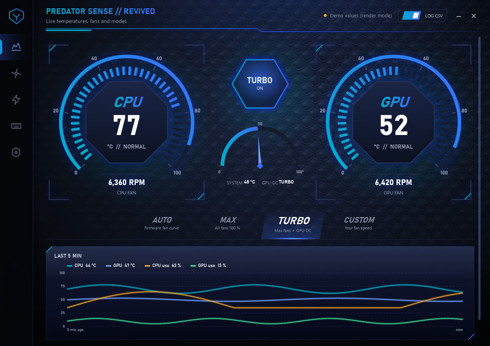
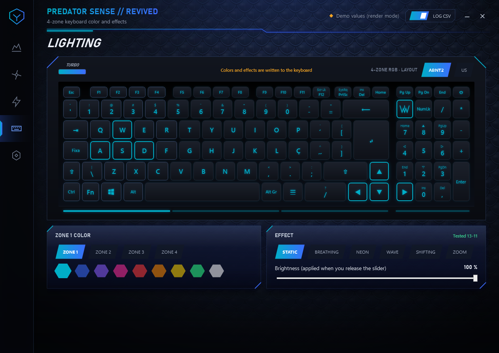
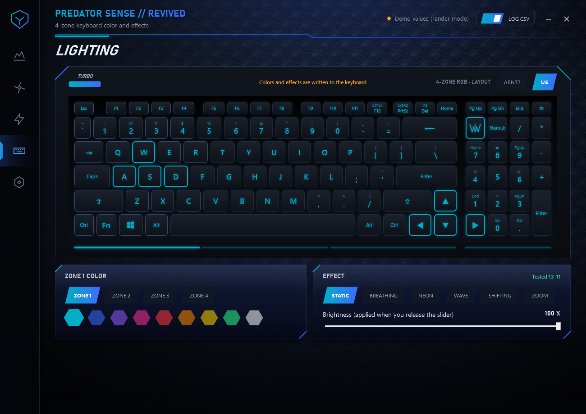

# Predator Sense Revived

A free, open-source replacement for Acer **PredatorSense** on the **Predator Helios 300 PH315-52** (2019).

Acer stopped updating PredatorSense for this laptop in 2020. On current Windows 11 the original app shows its logo and closes, and the fans stay locked in whatever mode it left them. This app talks to the laptop firmware directly, so you get your fans, Turbo and keyboard lighting back.

> **Made entirely with [Claude Code](https://claude.com/claude-code).** Every line of code, the design and this documentation were written by an AI (Claude, by Anthropic), directed and tested by the owner of one PH315-52, who is a video editor and not a programmer. No human developer reviewed the code. Read [Safety](#safety) and [Security](#security) before you use it.



| Lighting (ABNT2) | Lighting (US) |
|---|---|
|  |  |

## Features

All tested on a real PH315-52 (BIOS 1.12, Windows 11). Every change is read back from the firmware after it is written.

| Feature | Status |
|---|---|
| CPU / GPU / system temperature, fan RPM, 5-minute history chart | works |
| Fan mode: Auto, Max, Custom speed per fan | works |
| Turbo on/off (LED, fans, GPU overclock), follows the physical TURBO key | works |
| GPU overclock: Normal / Faster / Turbo | works |
| CoolBoost | works |
| 4-zone keyboard color, effects (Breathing, Neon, Wave, Shifting, Zoom), brightness | works (effects cannot be read back) |
| Keyboard light timeout: 30 s or never (the firmware has only these two) | works |
| Boot animation and sound, Windows key lock, USB charging when off | works |
| Start with Windows (minimized, no UAC prompt), CSV sensor log, firmware snapshots | works |
| Thermal profiles, CPU overclock, battery charge limit | not in this laptop's firmware |

## Download and run

1. Get `PredatorSenseRevived.exe` from the [Releases](../../releases) page.
2. Install the [.NET 9 Desktop Runtime (x64)](https://dotnet.microsoft.com/download/dotnet/9.0) if Windows asks for it.
3. Run the exe and accept the administrator prompt. Firmware access needs admin rights.

Close or uninstall Acer PredatorSense first. Two programs that control the fans will fight each other.

The exe is not code-signed, so Windows SmartScreen can warn on the first run.

## Safety

- The app only reads until you click something. It never changes the firmware on start.
- Before the first change of each run it saves a snapshot of every value to `%LOCALAPPDATA%\PredatorSenseRevived\snapshots`.
- If you close the app while the fans are on Custom, it sets them back to Auto.
- Custom fan speed has a floor of 20 %. (0 % stops the fan.)
- It never touches BIOS settings.

**Use it at your own risk.** This software changes fan, power and lighting settings in your laptop's firmware. It comes with no warranty (see [LICENSE](LICENSE)).

## Other models

The firmware codes were verified on **one** laptop model. Other Acer Predator / Helios / Nitro laptops from about 2018 to 2021 use a similar interface, but a code can mean something else there.

On any other model the app starts **read-only**:

1. Open **System > SAVE SUPPORT FILE**. It includes a read-only dump of what your firmware answers.
2. Open a [model report](../../issues/new?template=model-report.yml) and paste the file.
3. Only if you accept the risk: **System > Safety > Unlock controls on this untested model**.

## Support

This is a hobby project, shared for free. **There is no promise of support, fixes or updates.** Reports are still welcome, and they help other owners:

1. In the app, open **System > SAVE SUPPORT FILE**, then **OPEN DATA FOLDER**.
2. Open an [issue](../../issues/new/choose) and paste the content of `support_....txt`.

The support file is plain text. Read it before you post it. It contains the firmware report (read only), the app's own log of what it did, the last firmware snapshot and the last sensor readings. It does **not** contain your user name, PC name, serial number, files or any network data. The app never connects to the internet and sends nothing by itself.

### Keyboard layouts

The Lighting page draws the real keyboard. Today it has **ABNT2** (drawn from a photo, [reference](docs/keyboard-ph315-52-abnt2.jpg)) and **US** (derived from the same deck, not yet checked against a photo). The 4 light zones are the same on every layout.

To add your layout, send a straight top-down photo of your keyboard in an issue, or add a case to `Layout()` in [`KeyboardView.cs`](src/PredatorSenseRevived/Controls/KeyboardView.cs).

## Security

- **Admin rights.** Firmware access needs them, so the whole app runs as administrator. Only run a copy you downloaded from this repository's Releases page, or built yourself.
- **Not signed.** The exe has no code signature. Compare the SHA-256 on the Releases page with `Get-FileHash PredatorSenseRevived.exe` in PowerShell.
- **Start with Windows.** This creates a scheduled task that starts the exe as administrator at logon, without a prompt. If the exe sits in a folder that normal programs can write to (Downloads, Desktop, another drive), a malicious program could replace it and gain admin rights. Before you switch this on, put the exe in a protected folder such as `C:\Program Files\PredatorSenseRevived\`. The app warns you when it is somewhere else.
- **No network.** The app opens no connections, has no updater and no telemetry.
- **No driver.** It uses only the WMI interface that Windows and the Acer firmware already provide. It does not install a kernel driver and does not touch BIOS settings.
- **Local data** is in `%LOCALAPPDATA%\PredatorSenseRevived` (settings, snapshots, logs). Delete the folder to remove it. To remove the startup task, switch "Start with Windows" off first.
- Found a security problem? Please open an issue.

## How it works

PredatorSense is only a front end. The laptop's firmware exposes two WMI classes in `root\WMI`: `AcerGamingFunction` (sensors, fans, Turbo, keyboard, misc settings) and `APGeAction` (CoolBoost, USB charging, light timeout). Each method takes one packed integer and returns one. The app calls them through the Windows WMI scripting objects, with no kernel driver and no extra packages.

Every code this app uses, and how it was verified, is in [docs/firmware-notes.md](docs/firmware-notes.md).

## Build from source

Requires the .NET 9 SDK on Windows.

```
dotnet publish src/PredatorSenseRevived -c Release -r win-x64 --self-contained false -p:PublishSingleFile=true -o release
```

Developer switches (no admin needed for the first three):

| Switch | What it does |
|---|---|
| `--demo` | Opens the window with sample values, no firmware access |
| `--render out.png --page dash\|fans\|perf\|light\|sys [--layout us]` | Draws a page to a PNG |
| `--selftest report.txt` | Presses every control in demo mode and reports what reacted |
| `--probe out.txt` | Read-only firmware dump (admin) |
| `--test-all report.txt` | Supervised write test of every feature, restores the start state (admin, PH315-52 only) |

## Credits

- Firmware encodings: [rusty-predator](https://github.com/yavcsd/rusty-predator) by yavcsd (MIT), whose `docs/firmware-interface.md` decoded PredatorSense 3.0 on a Triton 500.
- The Linux `acer-wmi` driver, for the sensor and fan layout.
- Written entirely with [Claude Code](https://claude.com/claude-code) (Anthropic). See the note at the top.

## Disclaimer

This project is not made, endorsed or supported by Acer. "Acer", "Predator" and "PredatorSense" are trademarks of Acer Inc., used here only to say what the software is compatible with. No Acer code is included.
